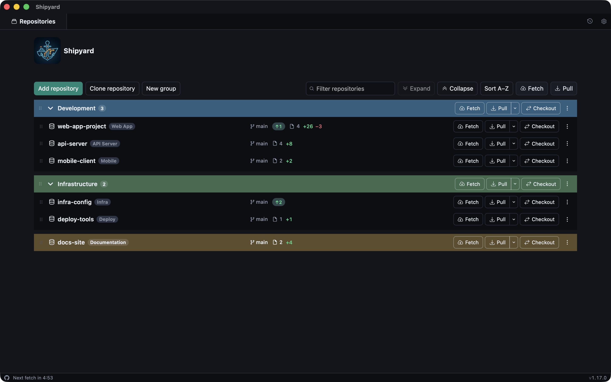
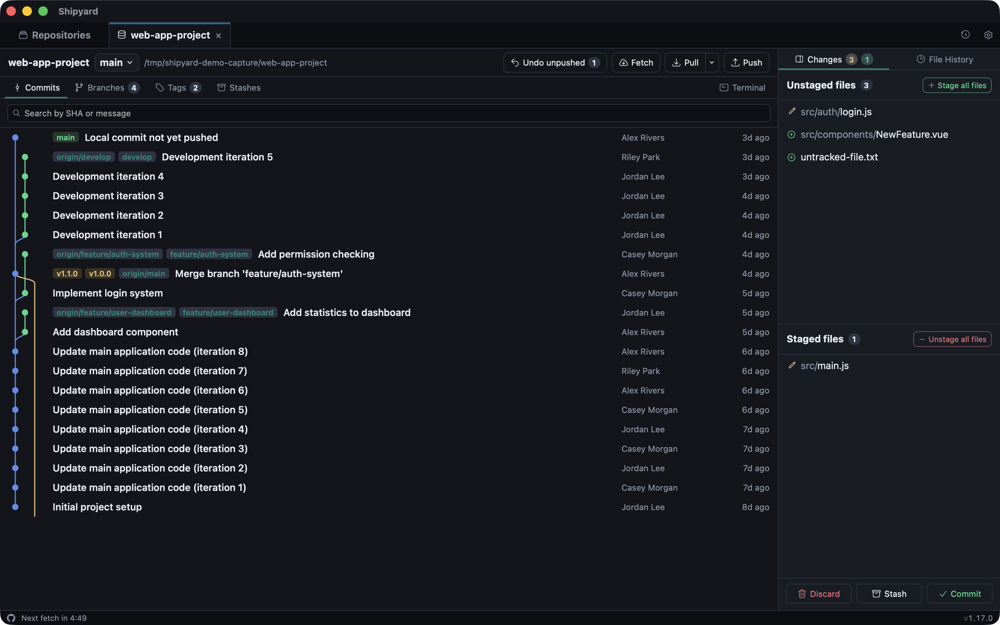
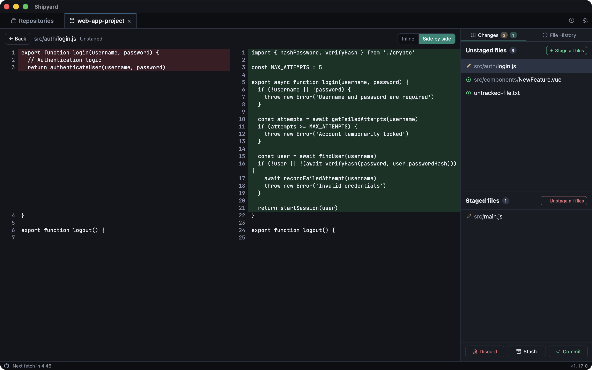
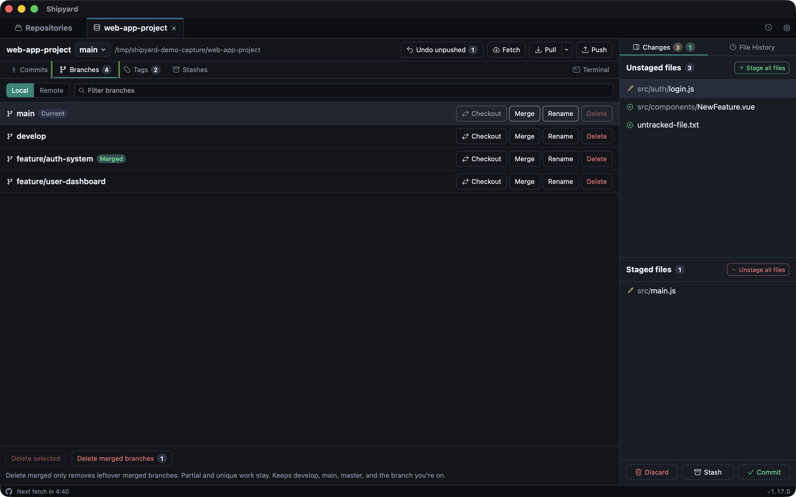
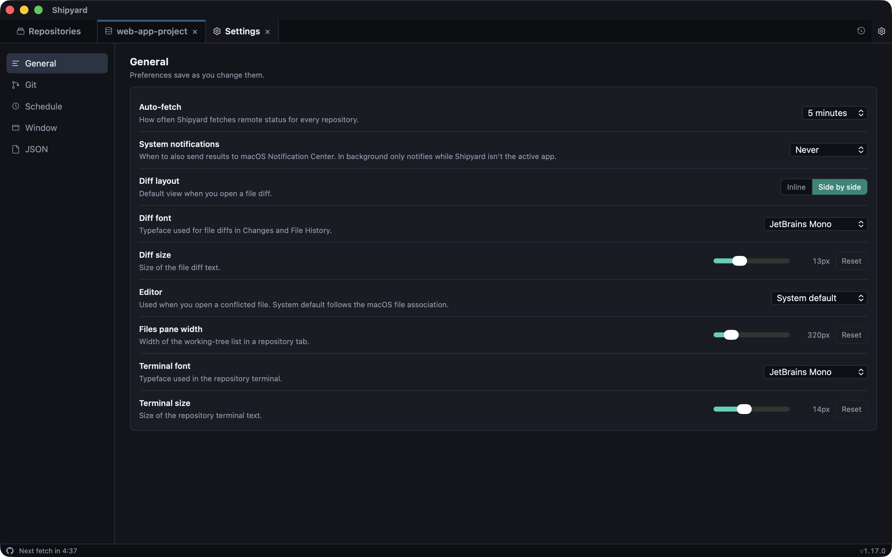
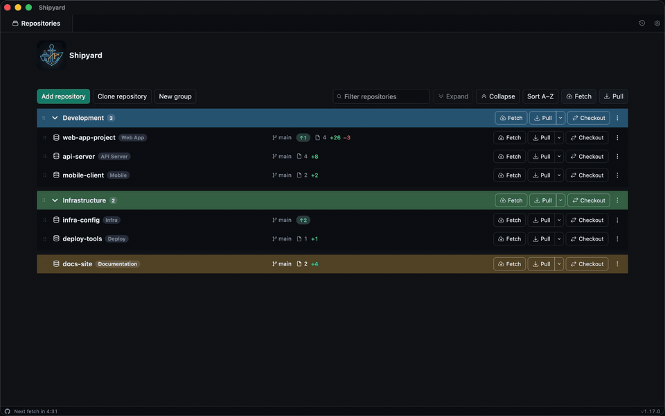

<p align="center">
  
</p>

<h1 align="center">Shipyard</h1>

<p align="center">
  A fast, native-feeling, open source Git client for macOS and Linux.
</p>

<p align="center">
  <a href="https://github.com/fylzero/shipyard/releases/latest/download/Shipyard-macos-arm64.dmg"></a>
  <a href="https://github.com/fylzero/shipyard/releases/latest/download/Shipyard-linux-x64.AppImage"></a>
  <a href="https://buymeacoffee.com/fylzero1"></a>
</p>

<p align="center">
  Other Linux downloads:
  <a href="https://github.com/fylzero/shipyard/releases/latest/download/Shipyard-linux-x64.deb">.deb</a> ·
  <a href="https://github.com/fylzero/shipyard/releases/latest/download/Shipyard-linux-x64.rpm">.rpm</a> ·
  ARM64 <a href="https://github.com/fylzero/shipyard/releases/latest/download/Shipyard-linux-arm64.AppImage">AppImage</a>,
  <a href="https://github.com/fylzero/shipyard/releases/latest/download/Shipyard-linux-arm64.deb">.deb</a>,
  <a href="https://github.com/fylzero/shipyard/releases/latest/download/Shipyard-linux-arm64.rpm">.rpm</a>
</p>

## What is Shipyard?

Shipyard is a local-first Git client built with Tauri, Vue, and Rust. It talks directly to the `git` binary already on your machine, so it uses your existing SSH agent, credential helper, and user identity—no separate login required.

Shipyard is designed for developers who manage multiple repositories and want a native desktop experience on macOS or Linux with powerful Git features without sacrificing speed or control.

## Features

- **Repository Groups**: Organize multiple repositories into named groups with bulk operations (pull all, checkout all to a branch)
- **Working Tree Management**: Stage, unstage, commit, amend, and discard changes with a clear file tree view
- **Branch Operations**: Create, checkout, delete, merge, rename, and track branches with visual indicators for merged/unmerged status
- **Remote Management**: Add, edit, and remove remotes; fetch, pull, and push with conflict detection
- **Commit History**: Visual commit graph with searchable history, file changes, and diffs
- **Stash Support**: Save, apply, pop, and drop stashes with individual stash inspection
- **Tag Management**: Create, delete, and view both lightweight and annotated tags
- **File History & Blame**: Track changes to individual files over time with line-by-line authorship
- **Diff Viewer**: Inline or split diff views with customizable fonts
- **Cherry-pick & Revert**: Apply or undo commits across branches
- **Integrated Terminal**: Open terminals in repository directories without leaving the app
- **Smart Refresh**: Configurable auto-refresh with active hours to avoid unnecessary Git operations
- **Editor Integration**: Open files directly in Cursor, VS Code, Zed, Sublime Text, PhpStorm, or your system default
- **Notifications**: Background change notifications when repositories update
- **Command History**: Inspect every Git command Shipyard runs under the hood
- **Pull Request Helpers**: Generate GitHub/GitLab pull request URLs for branches

## Screenshots

### Dashboard with Repository Groups



### Commit History and File Changes



### Working Tree Management



### Branch Management



### Repository Settings



### Demo



## Download and Install

### Requirements

- **macOS**: Apple Silicon (ARM64) required. Intel Macs are not currently supported.
- **Linux**: x64 or ARM64 with WebKitGTK 4.1 (Ubuntu 22.04, Debian 12, Fedora 36, or newer)
- **Git**: Must be installed and available in your PATH

### Installation on macOS

1. Download the latest release: [Shipyard-macos-arm64.dmg](https://github.com/fylzero/shipyard/releases/latest/download/Shipyard-macos-arm64.dmg)
2. Open the DMG and drag Shipyard to your Applications folder
3. Launch Shipyard from Applications

### Installation on Linux

Pick one package. Each one updates itself from **Help → Check for Updates…**; the `.deb` and `.rpm` ask for your password to install the update.

| Package | Install |
| --- | --- |
| [AppImage](https://github.com/fylzero/shipyard/releases/latest/download/Shipyard-linux-x64.AppImage) (any distro) | `chmod +x Shipyard-linux-x64.AppImage`, then run it |
| [.deb](https://github.com/fylzero/shipyard/releases/latest/download/Shipyard-linux-x64.deb) (Debian, Ubuntu, Mint) | `sudo apt install ./Shipyard-linux-x64.deb` |
| [.rpm](https://github.com/fylzero/shipyard/releases/latest/download/Shipyard-linux-x64.rpm) (Fedora, RHEL, openSUSE) | `sudo dnf install ./Shipyard-linux-x64.rpm` |

Use the `arm64` files on ARM machines. The `.deb` and `.rpm` install WebKitGTK for you.

To open conflicted files in an editor, its command has to be on your `PATH`: `cursor`, `code`, `phpstorm`, `subl`, or `zed`. **System default** uses your desktop's default app for the file type.

## Development

Want to build Shipyard from source or contribute? You'll need **Bun**, **Rust**, **Git**, and a C toolchain: **Xcode Command Line Tools** on macOS, or the **WebKitGTK** development packages on Linux.

### Prerequisites

#### 1. Native build tools

**macOS:** Xcode Command Line Tools provide the C/C++ compiler Rust uses.

```bash
xcode-select --install
```

If already installed, confirm with:

```bash
xcode-select -p
```

You should see `/Library/Developer/CommandLineTools` or an Xcode path.

**Linux:** install a compiler and WebKitGTK. On Debian or Ubuntu:

```bash
sudo apt install build-essential curl libwebkit2gtk-4.1-dev libxdo-dev libssl-dev librsvg2-dev libayatana-appindicator3-dev
```

For Fedora, Arch, and other distros, see [Tauri's Linux prerequisites](https://v2.tauri.app/start/prerequisites/#linux).

#### 2. Bun

Install with the official script from [bun.sh](https://bun.sh/):

```bash
curl -fsSL https://bun.sh/install | bash
bun --version
```

#### 3. Rust

Tauri compiles the native app with `cargo`. Install the official toolchain with [rustup](https://www.rust-lang.org/tools/install):

```bash
curl --proto '=https' --tlsv1.2 -sSf https://sh.rustup.rs | sh
```

Accept the defaults, then **open a new terminal**. Confirm:

```bash
cargo --version
rustc --version
```

You do not need to `source` anything for `bun run tauri dev`. That script already prepends `$HOME/.cargo/bin` to `PATH`.

#### 4. Git

```bash
git --version
```

Homebrew Git, your distro's `git` package, and `/usr/bin/git` all work. Shipyard shells out to whatever `git` is on your PATH.

### Building and Running

#### Clone the repository

```bash
git clone https://github.com/fylzero/shipyard.git
cd shipyard
```

#### Install dependencies and start the app

```bash
bun install
bun run tauri dev
```

This command:

1. Starts Vite on `http://localhost:1430` for the Vue UI
2. Compiles the Rust/Tauri shell
3. Opens the native Shipyard window

The **first** `tauri dev` (or `tauri build`) downloads crates and compiles from scratch, which often takes several minutes. Later runs are much faster.

#### Export a native app

```bash
bun run tauri build
```

On macOS, the build produces:

| Artifact | Path |
| --- | --- |
| App bundle | `src-tauri/target/release/bundle/macos/Shipyard.app` |
| Disk image | `src-tauri/target/release/bundle/dmg/Shipyard_<version>_aarch64.dmg` |

To run it locally, open the `.app` (or drag it to `/Applications`). macOS Gatekeeper may warn that an unsigned local build is unidentified: right-click the app, choose **Open**, then confirm.

On Linux, the build produces:

| Artifact | Path |
| --- | --- |
| AppImage | `src-tauri/target/release/bundle/appimage/Shipyard_<version>_amd64.AppImage` |
| Debian package | `src-tauri/target/release/bundle/deb/Shipyard_<version>_amd64.deb` |
| RPM package | `src-tauri/target/release/bundle/rpm/Shipyard-<version>-1.x86_64.rpm` |

### Publishing Signed Releases

Pushing a `v*` tag runs the Release workflow. It builds and notarizes the macOS app first, then builds the Linux x64 and ARM64 packages and adds them to the same GitHub release.

See [macOS release setup](docs/macos-releases.md) for Apple enrollment, repository secrets, and the signing and notarization checks, and [Linux releases](docs/linux-releases.md) for the Linux packages and how they update.

### Troubleshooting

**`failed to run 'cargo metadata' ... No such file or directory (os error 2)`**  
Rust is not installed. Run step 3 above, open a new terminal, and confirm `command -v cargo` prints `/Users/<you>/.cargo/bin/cargo`. If rustup did not update `~/.zshrc`, add `. "$HOME/.cargo/env"` there once.

**`xcrun: error: invalid active developer path`**  
Xcode Command Line Tools are missing or stale. Run `xcode-select --install` (or `sudo xcode-select --reset` after installing Xcode).

**`The system library 'webkit2gtk-4.1' required by crate 'webkit2gtk-sys' was not found`** (Linux)  
The WebKitGTK development package is missing. Install the Linux packages from step 1.

**`Could not open the file in Visual Studio Code`** (Linux)  
The editor's command (`code` for VS Code) is not on the `PATH` Shipyard was launched with. Install the editor's shell command, or pick **System default** in General settings.

**Vite starts but no native window**  
Leave the first Rust compile running. If it fails, the error is in the same terminal as `bun run tauri dev`.

**Frontend only (browser, no native APIs)**  
`bun run dev` serves the Vue app at `http://localhost:1430`. Git, dialogs, and other Tauri APIs need `bun run tauri dev`.

## Contributing

Contributions are welcome! Please see [CONTRIBUTING.md](CONTRIBUTING.md) for development setup, code style guidelines, and how to submit pull requests.

## License

MIT
